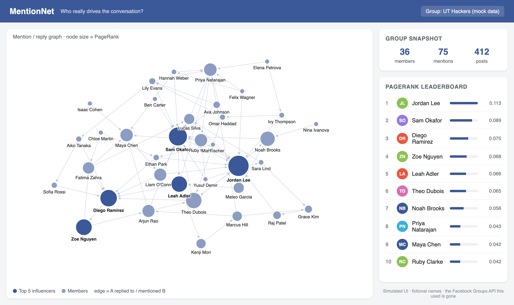

# MentionNet

> **Archived.** A 2016 hackathon project by [@afloresescarcega](https://github.com/afloresescarcega) and [@killvung](https://github.com/killvung). It no longer runs. Kept for reference only.

MentionNet ranked the members of a Facebook Group by influence. It scraped who replied to or mentioned whom, built a directed graph from those interactions, and ran PageRank over it. You could then see who actually drove the conversation, not just who posted most.

## What it would have looked like

The original frontend was a bare D3 force graph and was never finished. Below is a mock of the intended UI, rendered with fictional names and randomly generated data. No real group data was used.

The mock's source is in [`docs/mock/index.html`](docs/mock/index.html). It uses the same PageRank formulation as `PageRank.py`, with damping 0.85.

## How it worked

| File | Role |
| --- | --- |
| `facebookHandler.py`, `facebook_scrap_multithread.py` | Pull a group's posts and comment threads from the Facebook Graph API (v2.8) and build the mention graph. |
| `PageRank.py`, `RunPageRank.py` | Iterative PageRank over the graph. Writes scores into `facebook_graph.json`. |
| `RunPageRankDemo.py` | PageRank on a hand-built five-node toy graph. Runs offline. |
| `application.py`, `templates/index.html` | Flask app (deployed to AWS Elastic Beanstalk) serving `/data` and a D3 force layout. |

## Why it's dead

- **The data source is gone.** It relied on reading Facebook Group feeds through the Graph API with a Graph Explorer token. Meta restricted Groups API access in 2018 and has since deprecated the Groups API entirely. Graph API v2.8 itself was retired years ago.
- **The deployment is gone.** The Elastic Beanstalk environment no longer exists.

You can still run `python RunPageRankDemo.py` to see the PageRank step on its own.
